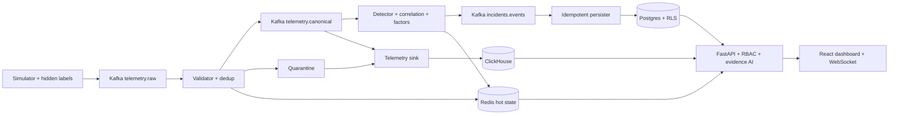
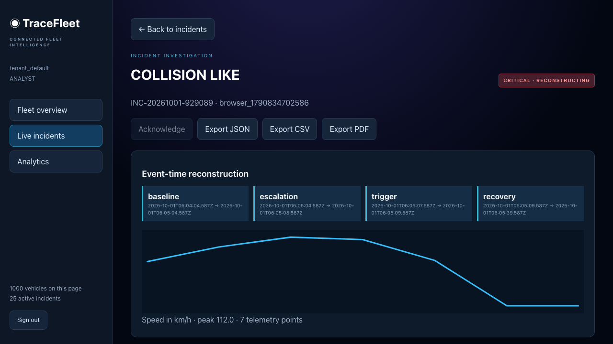
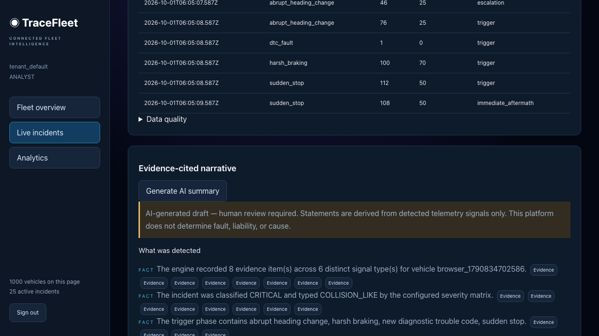

# TraceFleet

TraceFleet reconstructs connected-fleet incidents from telemetry. A simulator feeds Kafka; deterministic detector, correlation, severity and factor plug-ins turn those events into evidence-backed investigations. The dashboard provides fleet state, live incidents, timelines, analytics, operations and tenant administration. AI explains cited evidence and never assigns fault.

## Quick start

Prerequisites: Docker Desktop with Compose, Node 22, Python 3.12+ and Make. The containers include the Python runtime; local Python is needed for development checks.

```sh
cp .env.example .env
make up
make demo
```

Open [the dashboard](http://localhost:5173). Tenant `tenant_default`; users `viewer`, `analyst`, `manager`, `admin`; local password `tracefleet-demo`. Viewer sees masked locations. Analyst can acknowledge, export and generate summaries. Manager can close incidents and inspect operations. Admin manages users and erasure requests. Demo credentials are enabled only for local use.

`make demo` starts services, applies migrations, seeds the selected profile and injects six synthetic scenarios. It preserves existing data. A detected incident opens after its post-event window closes or the configured reconstruction timeout. The API is at [localhost:8000/docs](http://localhost:8000/docs); Grafana at [localhost:3000](http://localhost:3000) (`admin/admin` locally). No LLM key is required: the deterministic mock provider supports the full investigation flow.

For Mistral summaries, set `LLM_PROVIDER=mistral`, `MISTRAL_API_KEY`, and optionally `MISTRAL_MODEL` (default `mistral-small-latest`) in `.env`, then run `docker compose up -d --no-deps --wait api`. Generating a summary sends its evidence package to Mistral; citation validation and auditing apply to every provider. Cached summaries are scoped to the provider and model.

## Architecture



The API discovers enabled modules; YAML controls feature dependencies, thresholds, correlation windows, severity, roles, privacy and retention. Consumers commit each partition only after durable output succeeds. Kafka provides replay; content-derived keys and database upserts prevent duplicate incidents. Redis checkpoints preserve in-progress detection across a consumer restart. Postgres stores incident truth, while ClickHouse provides historical telemetry and rollups. See [architecture](docs/architecture/system.md), [extension guide](docs/EXTENDING.md) and the [runbook](docs/RUNBOOK.md).

## Investigation screenshots




## Verification

```sh
python3 -m venv .venv
.venv/bin/python -m pip install -r requirements.txt
npm --prefix apps/web ci
make test lint typecheck
make up
make coverage
node apps/web/node_modules/@playwright/test/cli.js install chromium
node apps/web/node_modules/@playwright/test/cli.js test --config apps/web/playwright.config.ts
make evaluate chaos-recover
make bench load-test
make soak SOAK_MINUTES=5
make scan k8s-validate
```

Reports are saved under `artifacts/`. The coverage gate includes the real PostgreSQL, Kafka, Redis and ClickHouse integration tests; local tests skip those unless explicitly enabled. CI starts a migrated stack, runs coverage and browser checks, exercises recovery, evaluates labels and uploads reports.

The final checks are in [VERIFICATION](docs/VERIFICATION.md). Measured results and limits are in [BENCHMARKS](docs/BENCHMARKS.md), [ACCEPTANCE](docs/ACCEPTANCE.md) and [PROGRESS](docs/PROGRESS.md). Optional pgvector similarity is intentionally disabled. The optional anomaly plug-in has a robust statistical fallback; `PYTHONPATH=.:apps/stream-processor:apps/simulator .venv/bin/python scripts/compare_anomaly.py` generates its comparison report.

## Deployment boundary

Compose is a single-node development environment. Production requires replicated datastores, managed secrets, TLS, backup/restore drills, verified network policies and deployment-specific load/soak testing. `make k8s-validate` renders both overlays; it does not deploy a cluster. Kubernetes includes API/processors/web, migration and scheduled retention/erasure jobs. Supply the required JWT secret containing `jwt_private.pem` and `jwt_public.pem`, replace the placeholder datastore secrets, build the web image with `--target production`, and configure ingress and datastore network selectors before applying an overlay.

The 100,000-vehicle seed is measured; 100,000 events/second on production hardware is not claimed. Synthetic scenario accuracy is not a real-world safety validation. See [THREAT_MODEL](docs/THREAT_MODEL.md) for remaining deployment risks.
