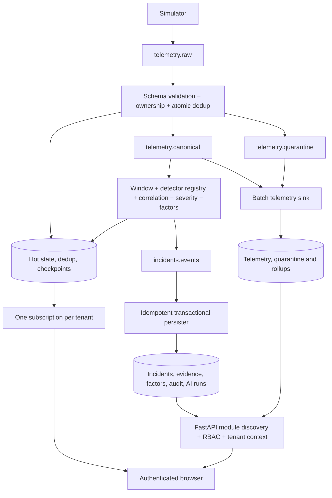
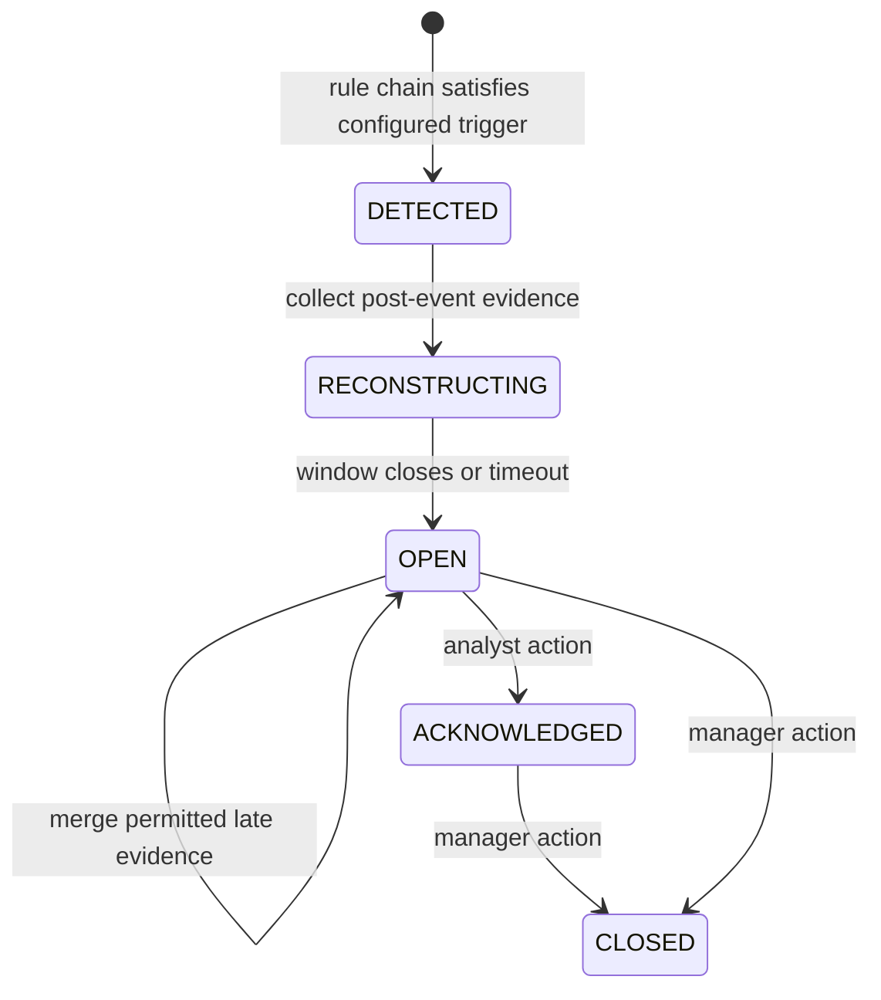

# System architecture

TraceFleet has an operational path for incident truth and a telemetry path for historical analytics. Both consume durable Kafka records. Detection runs before AI, and hidden scenario labels never enter Kafka or detector input.

## Event processing guarantees

Each consumer commits the highest processed offset plus one for every partition after its handler succeeds. Producer flush checks delivery callbacks; durable DLQ publication precedes poison-message commits. Downstream store failures pause/retry the batch without committing. Sink batches flush before offsets advance. Postgres upserts use the incident idempotency key and preserve human lifecycle decisions during replay.

Validator dedup claims remain pending until canonical publication succeeds. A replay from the same source offset can complete an interrupted claim. Redis latest-state writes compare event time atomically, so late samples cannot rewind the map. Incident windows, candidates and cooldown are checkpointed before source offsets advance; checkpoint writes are batched. In-memory state rolls back after a failed batch. This is at-least-once processing with idempotent materialization, not an exactly-once distributed transaction.

## Tenant and privacy boundaries

API authentication uses RS256 access/refresh tokens. Permissions come from the validated role catalogue. Postgres requests connect through a non-owner, non-BYPASSRLS role and set transaction-local tenant context; the SQLAlchemy session reapplies that context after a commit. Child evidence/factor/history policies join their parent incident. Explicit tenant filters remain in API queries. ClickHouse reads bind a tenant parameter, and Redis keys/pub-sub channels include the verified tenant.

Location and VIN precision follow role permissions. Audit rows are append-only for the application role; only the owner retention function can purge expired audit records. Erasure removes incident-derived records, pseudonymises the vehicle, deletes raw telemetry, per-vehicle rollups and quarantine data, and clears Redis state/checkpoints/caches. A minimal erased-vehicle ledger suppresses reingestion. Anonymous tenant selection is not a production authentication mechanism.

## Observability and deployment

W3C trace headers follow simulator → validator → canonical publish → incident/sink → incident publish → persister. Parent-based root sampling defaults to 10%; use `OTEL_TRACES_SAMPLER_ARG=1` for a diagnostic run. Role-specific metrics expose throughput, quarantine, dedup, lag, pause state, store failures and latency. Prometheus validates 16 alert rules; Grafana contains pipeline, incident, store, API and AI dashboards. Kubernetes provides scheduled retention and erasure jobs.

Redis checkpoints and the erasure ledger require durable, protected Redis storage; treating every Redis key as disposable can compromise recovery/privacy guarantees. Kafka retains source records until topic retention expires. Production needs replication, ACLs, protected owner credentials, shared signing keys, TLS, backup/restore drills and correctly selected network-policy destinations. See the ADRs and threat model for CAP/PACELC tradeoffs.
